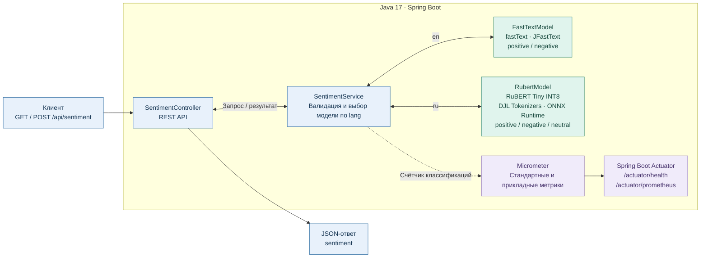

# Sentiment Analysis Service

Учебный проект по дисциплине «Оркестрация». Представляет собой REST-сервис для анализа тональности текстов на английском и русском языках. Проект предназначен для изучения контейнеризации Java-приложений, развёртывания и масштабирования в Kubernetes, мониторинга с помощью Prometheus и Grafana.

## Модели анализа тональности

| Язык | Модель | Результаты классификации |
|---|---|---|
| Английский (`en`) | [fastText Yelp Review Polarity](https://fasttext.cc/docs/en/supervised-models.html) | positive, negative |
| Русский (`ru`) | [RuBERT Tiny Sentiment Balanced (ONNX INT8)](https://huggingface.co/onnx-community/rubert-tiny-sentiment-balanced-ONNX) | positive, negative, neutral |

Используются готовые обученные модели. Они загружаются при старте приложения; сервис выбирает модель в зависимости от языка запроса. Русскоязычная модель использует токенизатор с ограничением входной последовательности до 512 токенов.

## Технологии и архитектура

Среда разработки и сборки: Java 17, Gradle 8.14.3 (Kotlin DSL). Контейнеризация и публикация: Docker, GitHub Actions, GitHub Container Registry (GHCR).

`SentimentController` принимает HTTP-запросы, `SentimentService` проверяет входные данные и выбирает модель (`FastTextModel` или `RubertModel`). Сервис возвращает результат классификации и обновляет счётчик метрик.



### Библиотеки и версии

Зависимости версии приложения 1.0.3. Версии компонентов Spring и связанных библиотек определяются Spring Boot BOM 4.1.3; для Tomcat, Logback и Commons Codec заданы отдельные ограничения версий в `build.gradle.kts`.

| Библиотека | Версия | Назначение |
|---|---|---|
| Spring Boot (`spring-boot-starter-webmvc`) | 4.1.3 | REST API и конфигурация приложения |
| Spring Boot Actuator (`spring-boot-starter-actuator`) | 4.1.3 | Health и метрики |
| Spring Framework (включая Spring MVC) | 7.0.11 | Веб-приложение и управление компонентами |
| JFastText (`jfasttext`) | 0.5 | Запуск английской модели fastText |
| ONNX Runtime (`onnxruntime`) | 1.20.0 | Запуск русскоязычной модели RuBERT |
| DJL Tokenizers (`tokenizers`) и DJL API | 0.39.0 | Токенизация текста для RuBERT |
| Micrometer Core и Prometheus Registry | 1.17.3 | Сбор и экспорт метрик |
| Prometheus Java Client (`prometheus-metrics-*`) | 1.7.0 | Представление метрик Prometheus |
| Apache Tomcat Embedded (`core`, `el`, `websocket`) | 11.0.29 | Встроенный HTTP-сервер |
| Jackson (`jackson-core`, `jackson-databind`, группа `tools.jackson.core`) | 3.1.8 | Обработка JSON |
| Logback (`logback-classic`, `logback-core`) | 1.6.8 | Логирование |
| Apache Commons Codec | 1.23.0 | Вспомогательная транзитивная библиотека |

Библиотеки для тестирования:

| Библиотека | Версия | Назначение |
|---|---|---|
| Spring Boot Starter Test | 4.1.3 | Набор тестовых зависимостей |
| Spring Test (MockMvc) | 7.0.11 | Проверка HTTP API |
| JUnit Jupiter и JUnit Platform Launcher | 6.0.3 | Написание и запуск тестов |
| Mockito | 5.23.0 | Поддержка тестовых объектов |
| AssertJ | 3.27.7 | Проверка результатов |
| Jayway JsonPath | 2.10.0 | Проверка полей JSON |

В таблицах приведены все прямые зависимости, явно заданные ограничения и основные транзитивные библиотеки. Версии, управляемые BOM, приведены по [документации Spring Boot 4.1.3](https://docs.spring.io/spring-boot/4.1/appendix/dependency-versions/coordinates.html). Полное дерево фактически разрешённых зависимостей (включая вспомогательные транзитивные библиотеки) можно получить из Gradle:

```powershell
.\gradlew.bat dependencies --configuration runtimeClasspath
.\gradlew.bat dependencies --configuration testRuntimeClasspath
```

## Локальный запуск

Требуется JDK 17. Из корня проекта в PowerShell:

```powershell
powershell -ExecutionPolicy Bypass -File .\prepare.ps1
.\gradlew.bat bootRun
```

`prepare.ps1` загружает необходимые файлы моделей в каталог `models/` и проверяет их по контрольным суммам SHA-256 из `models.sha256`. В IntelliJ IDEA приложение можно запустить через класс `org.sentiment.SentimentApplication`.

Адрес приложения: `http://localhost:8085`.

## REST API

| Метод | Эндпоинт | Назначение |
|---|---|---|
| GET | `/api/sentiment?text=hello&lang=en` | Анализ текста |
| POST | `/api/sentiment` | Анализ текста из JSON |
| GET | `/actuator/health` | Проверка состояния приложения |
| GET | `/actuator/prometheus` | Метрики приложения |

Параметр `lang` принимает значения `en` и `ru` (по умолчанию `en`). Допустимая длина текста — от 1 до 2000 символов. Пустой текст, превышение длины и неподдерживаемый язык возвращают HTTP 400.

Пример POST-запроса:

```http
POST http://localhost:8085/api/sentiment
Content-Type: application/json

{"text":"Очень вкусная еда! Прекрасное обслуживание, всем рекомендую!","lang":"ru"}
```

Ответ:

```json
{"sentiment":"positive"}
```

## Тестирование

| Набор | Количество |
|---|---:|
| Автоматические тесты сервиса | 10 |
| Автоматические HTTP-тесты | 10 |
| Ручные запросы (`request.http`) | 23 |
| HTTP-проверки итогового Docker-контейнера | 28 |

Автоматические тесты используют реальные модели. Проверяются классификация на обоих языках, обработка некорректных запросов и работа метрик в контейнере.

Запуск тестов: `./gradlew test` (Linux) или `.\gradlew.bat test` (Windows). Отчёт: `build/reports/tests/test/index.html`.

## Контейнеризация и CI

Многоэтапная Docker-сборка выполняется для Linux AMD64. Для уменьшения размера образа используются сокращённая Java Runtime (jlink), Distroless и скрипт `scripts/slim-linux-jar.py`, исключающий нативные библиотеки других платформ. Обе модели входят в образ. Приложение запускается от непривилегированного пользователя.

### CI/CD

Workflow [`.github/workflows/ci.yml`](.github/workflows/ci.yml) запускается вручную через GitHub Actions (`workflow_dispatch`). Версия Docker-образа берётся из `build.gradle.kts`.

- Сборка приложения и Docker-образа, запуск автоматических тестов.
- Проверка REST API и метрик в контейнере без доступа к интернету с помощью `scripts/test-container.sh`.
- Проверка размера образа (строго менее 150 МБ).
- Публикация образа в GHCR при успешном прохождении проверок из ветки `master`.

Развёртывание приложения в Kubernetes выполняется вручную.

Размер образа версии 1.0.3 — **142,23 МБ** (142 232 750 байт) при установленном ограничении 150 МБ.

### Запуск готового образа

```bash
docker pull ghcr.io/vkuryndin/sentiment-analysis:1.0.3
docker run --rm -p 8085:8085 ghcr.io/vkuryndin/sentiment-analysis:1.0.3
```

## Мониторинг и оркестрация

Actuator предоставляет стандартные метрики HTTP-запросов, JVM и CPU. При успешной классификации увеличивается счётчик `sentiment_predictions_total` с метками `language` и `sentiment`.

### Конфигурации Kubernetes

Манифесты развёртывания находятся в каталоге `k8s/`.

| Файл | Назначение |
|---|---|
| [`deployment.yaml`](k8s/deployment.yaml) | Развёртывание приложения с тремя репликами, настройка ресурсов, readiness probe и аннотаций Prometheus |
| [`service.yaml`](k8s/service.yaml) | Service типа LoadBalancer, порт 80 с перенаправлением на порт приложения 8085 |
| [`ingress.yaml`](k8s/ingress.yaml) | Маршрутизация запросов `/api` через Traefik |
| [`hpa.yaml`](k8s/hpa.yaml) | Масштабирование от 3 до 5 реплик при целевом использовании CPU 40% от запрошенного ресурса |

Применение манифестов в Minikube:

```bash
minikube kubectl -- apply -f k8s/deployment.yaml -f k8s/service.yaml -f k8s/ingress.yaml -f k8s/hpa.yaml
```

Для работы HPA необходим Metrics Server, для Ingress — Traefik, для доступа через LoadBalancer в Minikube — `minikube tunnel`.

### Дашборды Grafana

Prometheus собирает метрики каждой реплики приложения через `/actuator/prometheus`. В каталоге `k8s/` находятся два дашборда:

| Файл | Назначение |
|---|---|
| [`sentiment-analysis-dashboard.json`](k8s/sentiment-analysis-dashboard.json) | Количество доступных реплик, HTTP-запросы, время ответа, ошибки, CPU и память подов, классификации по языкам и тональности |
| [`sentiment-analysis-jvm-dashboard.json`](k8s/sentiment-analysis-jvm-dashboard.json) | JVM Heap, потоки Java, паузы GC, CPU Java-процесса, время работы приложения и загруженные классы |

Оба JSON-файла импортируются в Grafana с выбором существующего источника данных Prometheus.

### Нагрузочное тестирование

Скрипт [`scripts/load-test.sh`](scripts/load-test.sh) предназначен для проверки работы приложения под нагрузкой и автоматического масштабирования HPA. Он отправляет восемь параллельных запросов на анализ русского текста в течение четырёх минут, с паузой 50 мс между группами запросов. Статистика выводится каждые пять секунд; при ошибке скрипт завершает работу после текущей группы запросов.

Запуск из корня проекта:

```bash
bash scripts/load-test.sh
```

В скрипте указан адрес Ingress `10.100.148.160`. При изменении адреса кластера его необходимо актуализировать в скрипте.

## Документация

- [JFastText](https://github.com/vinhkhuc/JFastText)
- [Исходная модель RuBERT](https://huggingface.co/cointegrated/rubert-tiny-sentiment-balanced)
- [ONNX Runtime Java](https://onnxruntime.ai/docs/get-started/with-java.html)
- [DJL Tokenizers](https://github.com/deepjavalibrary/djl/tree/v0.39.0/extensions/tokenizers)
- [Distroless](https://github.com/GoogleContainerTools/distroless)
